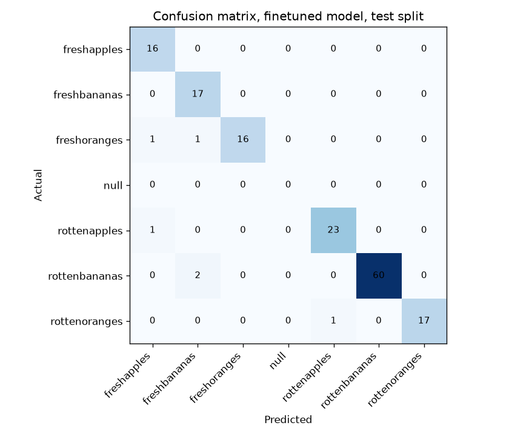
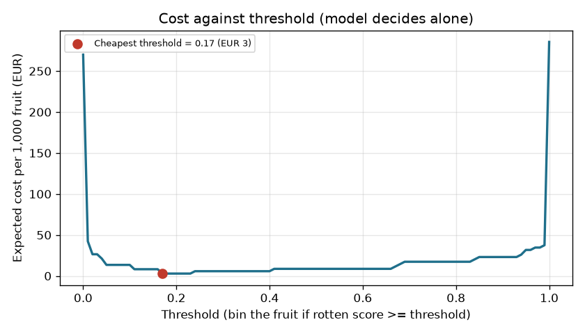

# Assignment 2 Report

- **Name**: Nicolas Aguado
- **Student ID**: 20446
- **Email**: naguado.ieu2022@student.ie.edu
- **Group**: BBADBA 5B

## Business problem, and the cost of being wrong

A supermarket's fruit distribution warehouse receives apples, bananas and oranges and has to decide, piece by piece, whether each one goes on to the shelf or into the bin. Today a worker on the sorting line makes that call by looking at the fruit. The model supports exactly that decision: from a photo of the fruit, should it **pass** (shelf), **fail** (bin) or be **sent to a person** to check?

The positive class is **rotten** (any of the three rotten classes). A positive prediction means the fruit is thrown away.

The two mistakes cost very different amounts:

- **False negative: a rotten fruit reaches the shelf.** The shop loses more than the fruit. A customer who buys it complains or asks for a refund on the whole purchase, the rot spreads to the fruit around it, and it hurts the shop's image for fresh produce.
- **False positive: a good fruit is binned.** The shop only loses what it paid for that one piece of fruit.

So a missed rotten fruit is the worse error, by roughly ten times under my assumptions (EUR 3.00 against EUR 0.30, justified below). This asymmetry drives every later choice. The threshold is pushed low so that anything that looks even slightly rotten is binned or checked, and accepting some wasted good fruit is the price of letting very little rotten fruit through.

## Dataset

- **Roboflow Universe**: workspace `fruit-onxba`, project `rotten-fresh-fruitclassification`, version `1`
- **Link**: https://universe.roboflow.com/fruit-onxba/rotten-fresh-fruitclassification
- **Task**: image classification. Each image is labelled with the type of fruit and whether it is fresh or rotten.
- **Classes**: freshapples, freshbananas, freshoranges, rottenapples, rottenbananas, rottenoranges, plus one stray class named `null` that holds a single training image.

The dataset serves the decision because its labels are exactly the call the sorter makes: fresh or rotten, for the three fruits the warehouse handles. It only resembles the real setting, though. These are photos collected for a public dataset, not frames from a camera mounted over a sorting line, so lighting, background and fruit lying on top of each other will differ in production.

## What the dataset's composition implies

| Class | Train | Valid | Test | Total | Positive |
|---|---:|---:|---:|---:|---|
| freshapples | 145 | 33 | 16 | 194 | no |
| freshbananas | 137 | 50 | 17 | 204 | no |
| freshoranges | 132 | 28 | 18 | 178 | no |
| null | 1 | 0 | 0 | 1 | no |
| rottenapples | 169 | 48 | 24 | 241 | yes |
| rottenbananas | 363 | 82 | 62 | 507 | yes |
| rottenoranges | 139 | 37 | 18 | 194 | yes |
| **All classes** | **1,086** | **278** | **155** | **1,519** | |

This is classification, so there are no bounding boxes and object size relative to the image cannot be computed from the labels. The median image resolution is recorded in `results/image_sizes.csv`, and every image is resized to 224 × 224 pixels for training.

What this composition implies:

- **The test set is small, so per-class numbers are shaky.** It has 155 images, and each fresh class has only 16–18. One mistake moves a fresh class's recall by about 6 percentage points, so differences of a few points between classes are noise, not findings.
- **The data is far more rotten than reality.** 62% of training images and 67% of test images are rotten, while I assume about 10% of real incoming fruit is. Two consequences follow. First, accuracy on the test set overstates how often the model is right in production, where most fruit is fresh. Second, the model's raw score was learned on a mostly rotten mix, so 0.5 is not a meaningful cut-off. This is why costs are weighted with the real-life base rate and the threshold is chosen by sweeping cost, not by taking 0.5.
- **Rotten bananas dominate.** They are 33% of all images and 40% of the test set, so they carry the headline number. A model that is good on bananas looks good overall even if it is weaker on the other fruits.
- **There is a data-quality problem.** The stray `null` class (1 image) is a labelling mistake in the dataset. It has no effect on results, but it would be removed in a cleaned version.
- **The test split may not hold in production.** As noted above, the photos do not come from the sorting line. The test number tells us the model learned what "rotten" looks like in these photos, not that it will reach 96% on the warehouse camera.

## Finetuning and baselines

- **Model**: `yolo11n-cls`, finetuned from the pretrained checkpoint.
- **Settings**: 15 epochs, image size 224, batch 32, seed 0.
- **Where trained**: on my own laptop (CPU), using `uv run python main.py train`. Training took 13.1 minutes.
- **Validation top-1 accuracy**: 0.993.

**Why classification and not detection.** The decision is made one piece of fruit at a time, so one image means one decision. Classification gives one score per image, which can be thresholded directly into pass, review or fail. Detection would add box locations the business does not need. It would also complicate costing, since mistakes would be counted per box rather than per piece of fruit.

Results on the same test split (155 images). "Rotten caught" and "fresh binned" use a 0.5 threshold. Cost uses each model's cheapest threshold under the cost assumptions below.

| Model | Accuracy (all classes) | Rotten caught | Fresh binned | Best cost per 1,000 fruit (EUR) |
|---|---:|---:|---:|---:|
| Finetuned yolo11n-cls | 0.961 | 0.971 | 0.000 | 2.89 |
| Pretrained COCO yolo11n, zero-shot | 0.148 | 0.000 | 0.000 | 270.00 |
| Trivial: always "rottenbananas" | 0.400 | 1.000 | 1.000 | 270.00 |

The finetuned model beats both baselines by a wide margin.

- **The COCO model knows the fruit but not the condition.** It can recognise apples, bananas and oranges, which are COCO classes, but it was never taught what "rotten" looks like. The best it can do is name the fruit and assume it is fresh, so it never catches a rotten one. Its 14.8% accuracy comes only from fresh fruit it happened to name correctly.
- **The trivial baseline bins everything.** It always answers the most common training class, rotten bananas, so in practice it throws all fruit away.
- **Why both baselines cost EUR 270.** Binning everything wastes the 90% of fruit that is fresh: 0.9 × EUR 0.30 × 1,000 = EUR 270. Even the zero-shot model's cheapest option is to bin everything, because that is cheaper than passing everything (EUR 300).

## Per-class evaluation and failure modes

| Class | Positive | Test images | Precision | Recall |
|---|---|---:|---:|---:|
| freshapples | no | 16 | 0.889 | 1.000 |
| freshbananas | no | 17 | 0.850 | 1.000 |
| freshoranges | no | 18 | 1.000 | 0.889 |
| rottenapples | yes | 24 | 0.958 | 0.958 |
| rottenbananas | yes | 62 | 1.000 | 0.968 |
| rottenoranges | yes | 18 | 1.000 | 0.944 |

The overall accuracy of 96.1% means 6 errors out of 155. They are not equally important:

- **The costly failure is rotten fruit called fresh.** This happened 3 times: 1 rotten apple and 2 rotten bananas. They are false negatives, the expensive error, and the only errors that would put rotten fruit on the shelf. They also explain the lower precision of freshapples and freshbananas: some of what the model calls "fresh banana" is really a rotten one.
- **The other 3 errors are harmless for the business.** A fresh orange was called a fresh apple, another fresh orange a fresh banana, and a rotten orange a rotten apple. The model got the fruit type wrong but the fresh/rotten call right, so the shelf/bin decision is unchanged.
- **No fresh fruit was called rotten,** so at a 0.5 threshold there are no false positives on the test set.

The model therefore fails in the expensive direction. That is why the chosen threshold sits well below 0.5: it trades a little wasted good fruit for catching more rotten fruit. Rotten bananas carry the headline number at 40% of the test set. Rotten apples, with the lowest recall of the rotten classes (0.958), are the class to watch.

## Cost matrix and operating point

| Item | Value | Why |
|---|---:|---|
| False negative: rotten fruit reaches the shelf | EUR 3.00 | Assumption. Covers the lost fruit, a likely refund or complaint on the customer's purchase (a bag of fruit costs a few euros), nearby fruit spoiling and damage to the shop's fresh-produce image. Set at about 10× a false positive. |
| False positive: good fruit binned | EUR 0.30 | Assumption. Roughly what the supermarket pays a wholesaler for one apple, banana or orange (around EUR 1.50 per kg at about 5 pieces per kg). |
| True positive: rotten fruit binned | EUR 0.00 | A rotten fruit is already worthless, so binning it costs nothing beyond the value already lost. |
| True negative: good fruit to shelf | EUR 0.00 | The normal outcome, used as the baseline. |
| Base rate: share of fruit really rotten | 10% | Assumption, not measured. Roughly 1 in 10 pieces reaching the sorting step is spoiled or damaged. |
| Fruit checked per day | 20,000 | Assumed volume for one regional warehouse sorting line. |
| Time for a worker to check one fruit | 3 s | A flagged piece only needs a quick look and a yes/no. |
| Worker cost per hour | EUR 20 | Fully loaded cost (wage plus employer social security), set deliberately on the high side for a Spanish warehouse worker. A lower wage only makes human review cheaper. |
| Shift length | 8 h | Standard working day. |
| Reviewers available | 1 | One existing worker can be moved onto checking flagged fruit. |

- **Cost of one human check**: 20 × 3 / 3,600 = EUR 0.017.
- **How expected cost is calculated**: on the test set I measure what share of rotten fruit and what share of fresh fruit end up passed, reviewed or binned. I then weight those shares with the 10% base rate, not the test set's 67%, and multiply by the costs above.

**Result**: sweeping the threshold from 0 to 1, the cheapest single threshold is **0.17**, giving EUR 2.89 per 1,000 fruit.

The cheapest threshold is far below 0.5 for two reasons. Missing a rotten fruit costs ten times more than wasting a good one, so it pays to bin on weak evidence. And the model's scores come from training data that was 62% rotten, so a score of 0.5 does not mean "50% likely rotten" in a warehouse where only 10% is.

**How sensitive these choices are:**

- **The cost ratio drives the threshold.** If a missed rotten fruit cost about the same as a wasted good one, the cheapest threshold would move up towards a more balanced cut-off. The 10:1 ratio is what makes a low threshold right.
- **The base rate matters in both directions.** If real rotten fruit is rarer than 10%, false alarms on fresh fruit weigh more and the threshold should rise. If it is more common, the threshold should fall.
- **Checking only pays when a miss is expensive enough.** Having a person check every piece (EUR 16.67 per 1,000) beats doing nothing as long as a rotten fruit on the shelf costs more than EUR 0.17, which is the cost of one check divided by the 10% base rate. Below that, no checking at all would be cheaper.

## What a person still has to check

- **Pass** (to the shelf): rotten score below **0.04**.
- **Fail** (to the bin): rotten score at or above **0.17**.
- **Review** by a worker: anything in between, where the model is unsure.

The two cut-offs were chosen by trying every pair and keeping the cheapest one whose review load fits the one available worker.

| Option | Cost per 1,000 fruit (EUR) | Checks per day | Workers needed |
|---|---:|---:|---:|
| Do nothing (everything goes to the shelf) | 300.00 | 0 | 0 |
| A person checks every piece | 16.67 | 20,000 | 3 |
| Model decides alone (threshold 0.17) | 2.89 | 0 | 0 |
| **Model + person checks the unsure ones** | **1.19** | **1,440** | **1** |

- **Review load**: 7.2% of fruit goes to a person. At 20,000 fruit a day that is 1,440 checks, or 1.2 hours of work at 3 seconds each. One worker covers it with most of the shift left for other tasks, so the load is realistic.
- **When one worker stops being enough**: the load would only exceed one full shift if a check took more than 20 seconds, or if volume grew to about 133,000 fruit a day.
- **Savings at 20,000 fruit a day**:
  - about EUR 5,980 a day against doing nothing;
  - about EUR 310 a day against a person checking everything, which would also need three workers instead of a fraction of one;
  - about EUR 34 a day against letting the model decide alone. That is small per day but around EUR 12,000 a year, for 1.2 hours of one worker's time.

**Would I ship it?** Yes, but not straight away. I would first run it in shadow mode: the model scores fruit on the real line while workers keep sorting as they do now. That would measure the real miss rate and the real share of rotten fruit on warehouse camera images, because the test set here is small and does not come from the line. If the shadow results hold, I would switch to the pass/review/fail setup above and re-sweep the thresholds with the measured figures.

## Limitations & next steps

- **Small test set.** 155 images, with 16–18 per fresh class, so per-class numbers have wide uncertainty. Next step: collect and label a larger test set.
- **Photos not from the sorting line.** Accuracy will probably drop on a real conveyor camera. Next step: gather labelled images from the actual line and finetune on them.
- **Costs and base rate are assumptions.** None were measured. Next step: replace them with real figures from the shop's waste records, complaint and refund data, and wage costs, then re-run `costing.py`.
- **The reviewer is assumed always right.** In reality a tired worker also makes mistakes, so the human band is slightly optimistic.
- **Only three fruits.** Any other fruit is out of scope, and the model would still force it into one of its classes.
- **Stray `null` class.** One mislabelled image; it should be removed in a cleaned dataset version.

## Generative AI use disclosure

I used Claude as an assistant throughout this assignment. It suggested the fruit-sorting framing and the dataset, help me with the code (`train.py`, `costing.py`, `app.py`, `settings.py`), guided me through setting up and running the project in VS Code,  I ran the pipeline on my own laptop, reviewed the outputs and this report, decided to keep these assumptions, and went through how each part works so that I can explain every decision.
